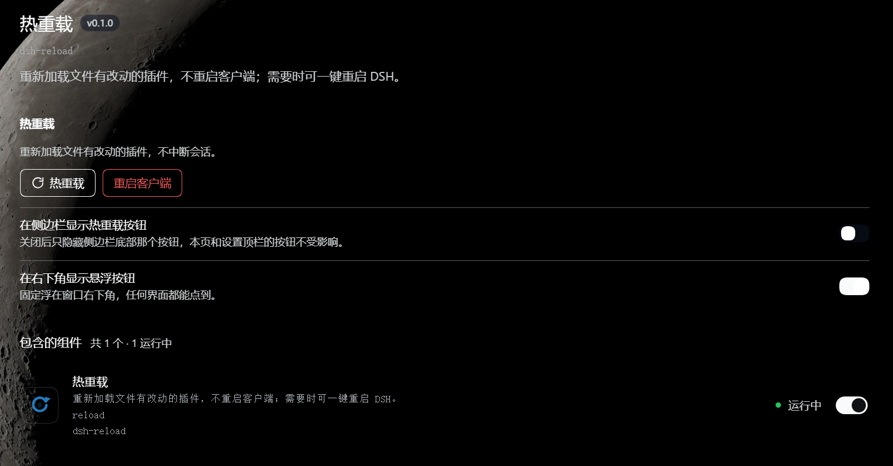

<div align="center">


# dsh-reload

**改完插件代码，点一下就让改动生效 —— 不用关掉再打开 DSH。**

[](https://github.com/deepseek-ai/deepseek-harness)
[](#license)

[快速开始](#-快速开始) · [怎么使用](#-怎么使用) · [常见问题](#-常见问题)

</div>

## 它解决什么问题

> DSH 不会自动重新加载你改过的插件代码 —— 本插件补上这个开关。

开发 DSH 插件时，改完代码、重新构建，界面却还是旧的。DSH 内置的 HMR 只监听 profile 配置，**`link:` 开发包的源码改动不在它的监听范围内**，结果就是「改完 → 必须重启 DSH → 才能看到效果」。

一次两次还好，调试一下午就是几十次重启。`dsh-reload` 把这件事变成一个按钮：

- ⚡ **点一下，改动就生效。** 重新加载文件有改动的插件，**不重启进程、不中断会话**，聊天记录和正在做的事都还在。
- 🔄 **需要时也能重启。** 有些改动（改 `package.json`、换依赖）必须整机重启，本插件也能一键完成，关掉后自动重新打开。
- 🛡️ **有任务在跑就不让重启。** 先检查是否有会话、后台任务或终端在运行，有就明确拒绝并列出是哪些，不会让你误丢工作。
- 🤖 **智能体也能触发。** 内置 `dsh_hot_reload` 工具，改完代码让 AI 自己重载，不用你动手。

## 🎯 三条设计原则

这个插件刻意做得很薄。三类决定贯穿全部代码：

### 1. 走官方路径，不生造分支

重载直接调用宿主的 `hmr.reconcileProfile()` —— 就是 DSH 自己重载插件用的那条路径。

有些同类插件会自己清 ESM/CJS 模块缓存、手动 dispose fiber、再重新 apply。那套序列很脆弱：顺序错一步，Loader 就会把插件写成 `disabled: true` 并**持久化到你的配置里**。本插件不重写这套逻辑，因此也不会以新的方式出错。

**代价**：无法提供「单个插件重载」。**收益**：宿主怎么保证自己的 HMR 可靠，本插件就怎么可靠。

### 2. 不污染模型上下文

插件对 AI 的影响只有**一个工具**：

| 项 | 本插件 |
|---|---|
| 系统提示注入（`systemPrompt.section` / `context`） | **0** |
| agent 上下文注入（`agent.inject`） | **0** |
| 注册的 skill | **0** |
| 工具数量 | **1** |
| 工具描述长度 | 349 字符 / 约 97 token |
| 工具参数 | **无**（JSON Schema 为空对象） |

同类插件常带 `action` / `target` / `reason` 等参数。本插件一个都不要 —— 该重载什么由文件系统决定，不需要模型判断，也就不存在「模型猜错插件名」这个失败模式。

**你的对话上下文里，这个插件只占一个工具位。**

### 3. 默认不占界面

装好后界面上什么都不会多出来。侧边栏按钮、右下角悬浮按钮**默认关闭**，需要时自己去插件页打开。

设置面板顶栏的两个按钮是唯一常驻入口 —— 因为它们是「随时能点到」的兜底，且不占正文空间。

## 📸 界面

插件自己的设置页，两个按钮加两个开关：



打开设置面板时，顶栏右侧始终有这两个按钮，任何设置页都能点到：


> 插件默认**不往界面上加任何东西**，需要侧边栏按钮或右下角悬浮按钮时，自己去插件页打开开关。

## 🚀 快速开始

### 1. 安装

**桌面端**：打开侧栏的 **插件** 页面，在安装入口输入下面的包名：

```text
dsh-reload
```

**命令行**：

```powershell
dsh plugin --profile desktop add dsh-reload
```

装好后**刷新一次页面**，入口才会出现（客户端模块图在页面加载时构建）。

### 2. 打开插件页

**设置 → 插件 → 热重载（dsh-reload）**。这里有两个按钮，以及两个可选的入口开关。

### 3. 改代码，点热重载

改完插件源码、重新构建后，点「热重载」即可。看到「已热重载 N 个插件」就生效了。

## 💬 怎么使用

### 三个入口，按习惯选

| 入口 | 位置 | 默认 |
|---|---|---|
| **侧边栏底部** | 设置按钮上方，展开时带文字 | 关 |
| **右下角悬浮按钮** | 32px 圆形图标，任何界面都能点 | 关 |
| **侧边栏「更多」菜单** | 展开后最下面一行「刷新插件」 | 常驻 |

设置面板顶栏的两个按钮**始终可用**，不需要开关。

### 让智能体自己重载

改完代码直接说：

```text
改完了，帮我热重载一下插件。
```

模型会调用 `dsh_hot_reload`。你也可以在 `AGENTS.md` 里约定「每次改完插件代码都要热重载」，让它成为默认动作。

### 什么时候必须重启客户端

| 情况 | 热重载够吗 |
|---|---|
| 改了插件源码并重新构建 | ✅ 够 |
| 改了 `package.json`（名称、依赖、`dsh.client` 配置） | ❌ 必须重启 |
| 换了依赖、动了 `pnpm-lock.yaml` | ❌ 必须重启 |
| 插件加载失败、变成 `failed` 状态 | ✅ 修好文件后再热重载一次即可 |

热重载返回的 `pending` / `restartReason` 非空时，就说明有模块必须重启才能生效。

## ❓ 常见问题

### 点了热重载，但界面没变？

按顺序检查：

1. **重新构建了吗？** 热重载只加载磁盘上的产出文件，源码改了但没构建，加载的还是旧代码。
2. **改的是 `package.json` 吗？** 那不会被检测到，需要重启客户端。
3. **看返回的提示。** 如果显示「没有检测到改动」，说明磁盘上没有插件文件变化 —— 这**不是错误**，通常是还没构建，或者刚才已经重载过了。

### 热重载会丢东西吗？

**不会丢会话和任务。** 它不碰进程，聊天记录、正在跑的任务、打开的终端都保留。

但**被重载插件的内存状态会清空**（包括本插件自己），因为插件是重新加载的。

### 为什么侧边栏那个按钮不见了？

Windows 上侧边栏一旦折叠，宿主会把整个底部区域隐藏 —— 这是 DSH 的行为，插件无法绕过。此时请用右下角悬浮按钮或设置面板顶栏的按钮。

### 重启时提示「有任务正在运行」？

这是故意的。重启会中断所有任务，所以插件先检查再执行。等任务结束，或先把它们停掉。

这个判断在 Host 侧做两次（点击前 + 执行前），防止检查与执行之间刚好有新任务启动。

### 和 npm 上的 `dsh-hot-reload` 有什么区别？

| | dsh-hot-reload | dsh-reload |
|---|---|---|
| 触发条件 | 插件**版本升级**（监听 lockfile） | **显式触发**：点按钮 / 调工具 |
| 目标场景 | 升级已安装的插件 | **开发插件**：改源码、重新构建 |
| 是否含整机重启 | 否 | 是 |

两者解决的问题不重叠，可以同时安装。

## ⚙️ 进阶

<details>
<summary>已知限制与边界</summary>

- **热重载会清空被重载插件的内存状态**（包括本插件自己）。
- **替换版本加载失败时，旧代码不再运行**，插件变为 `failed`，直到文件修好后再热重载一次。
- **只改 `package.json` 不会被检测** —— 这是 DSH 的官方限制。
- **重启客户端会中断所有任务**。新实例拉起后会做存活探测并重试最多 3 次；仍失败时日志在 `$DSH_HOME/dsh-reload/restart.log`，需手动双击图标。
- 重启仅支持 **Windows 桌面客户端**；`dsh web` 场景下按钮会禁用并说明原因。
- 刚装好或更新插件后，**需要刷新一次页面**才能看到入口。

</details>

<details>
<summary>开发与验证</summary>

源码即产物，没有构建步骤。改完直接热重载即可生效。

```sh
# 工具 schema 与实现的字段一致性（用 Host 自己的断言函数）
DSH_RUNTIME_DIR="<dsh 包根目录>" ELECTRON_RUN_AS_NODE=1 "<DeepSeek Harness.exe>" --expose-internals scripts/check-schema.mjs

# 槽位注册写法（含 keyed 槽位的 key 必须等于包名）
node scripts/check-slot-components.mjs

# 组件能否真实渲染（抓渲染期异常）
node scripts/render-probe.mjs

# 声明与路径检查
node scripts/inspect-graph.mjs

# 重启链路（存活探测 / 环境剥离 / 重试；用假主进程，不影响正在运行的 DSH）
node scripts/restarter-drill.mjs
```

设计文档在 [docs/](docs/)，先从 [docs/README.md](docs/README.md) 看起。

</details>

## License

MIT
